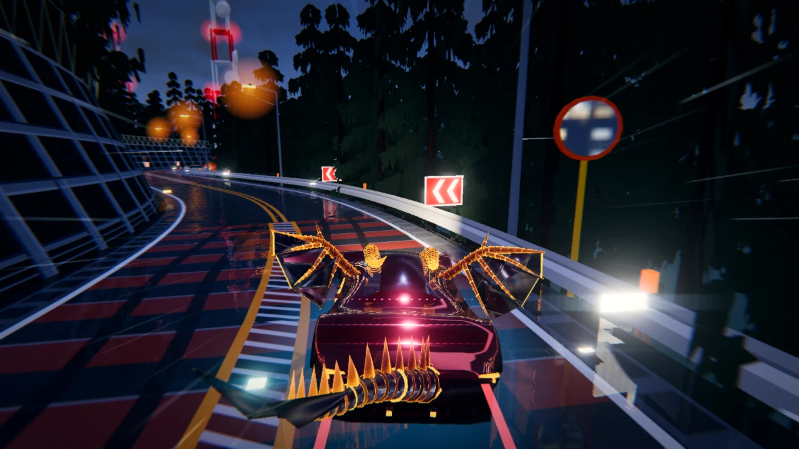
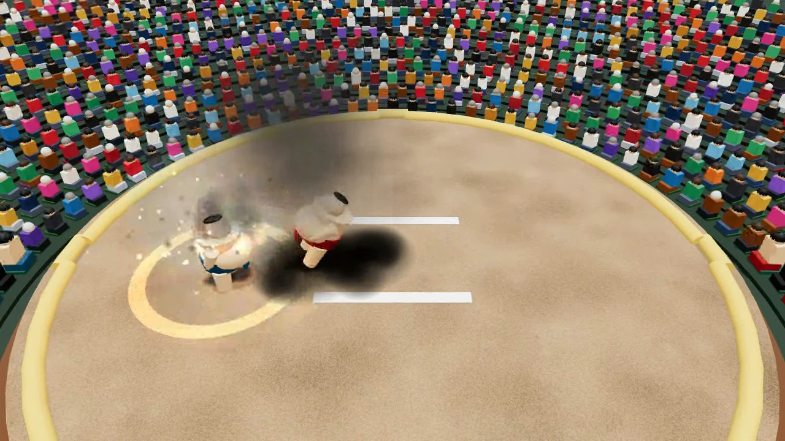
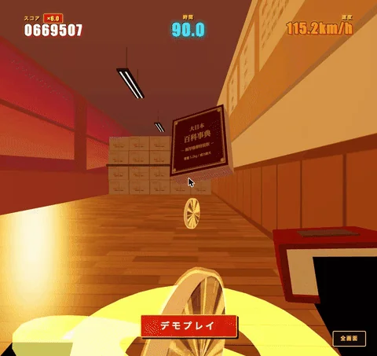
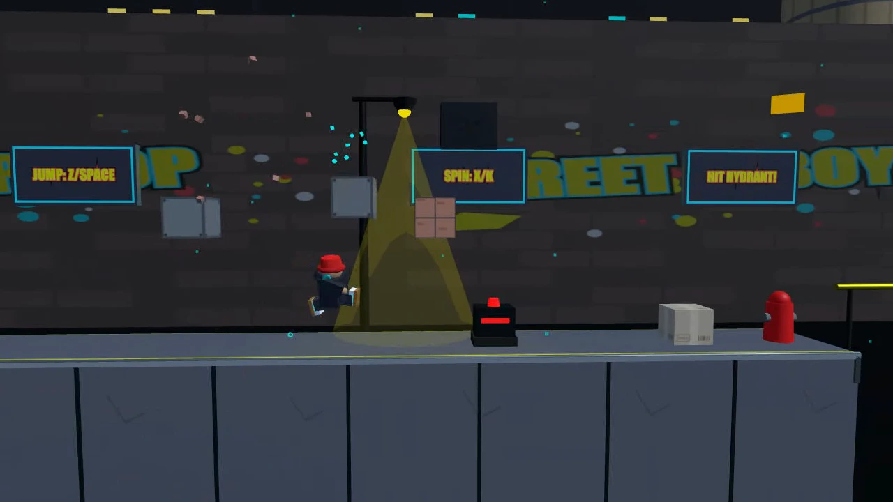
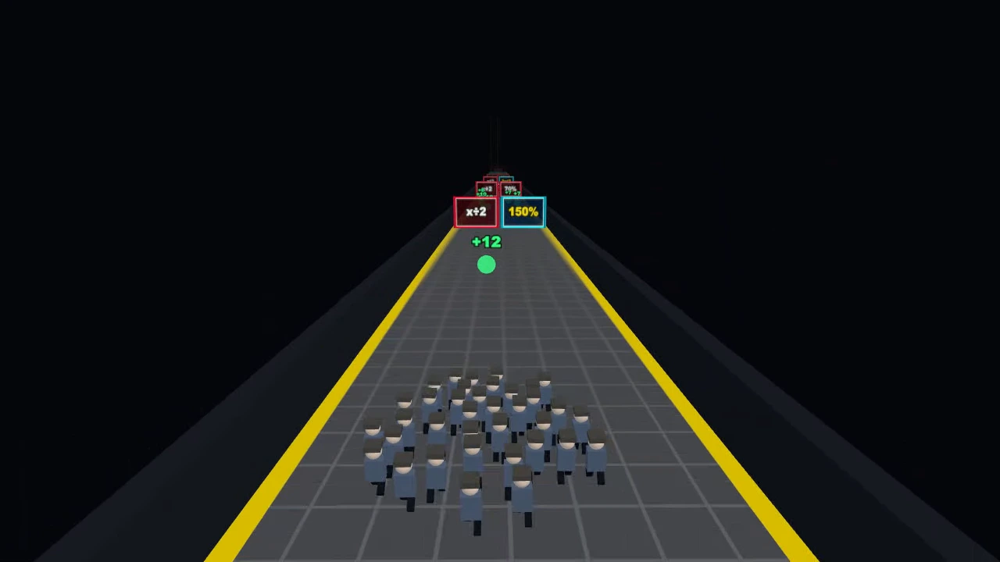
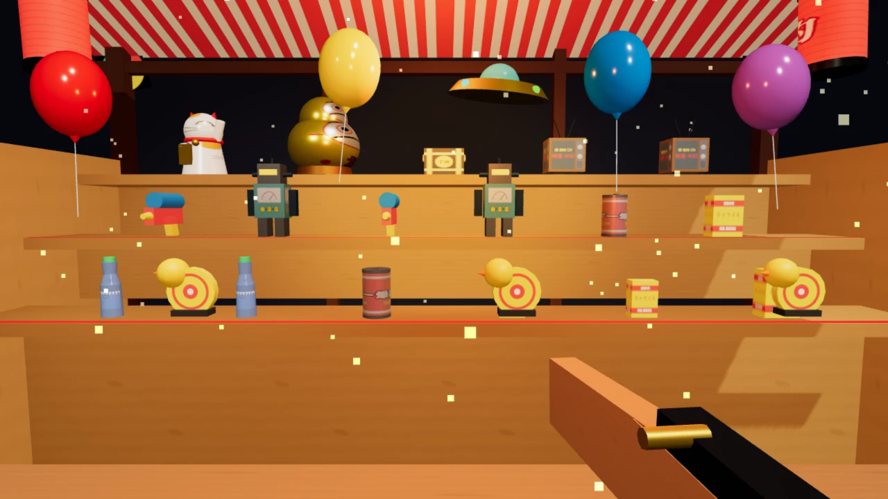
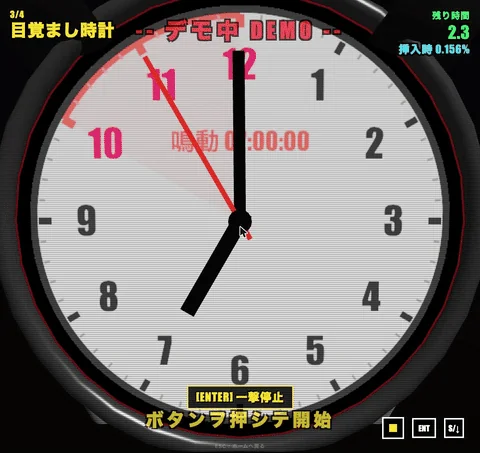
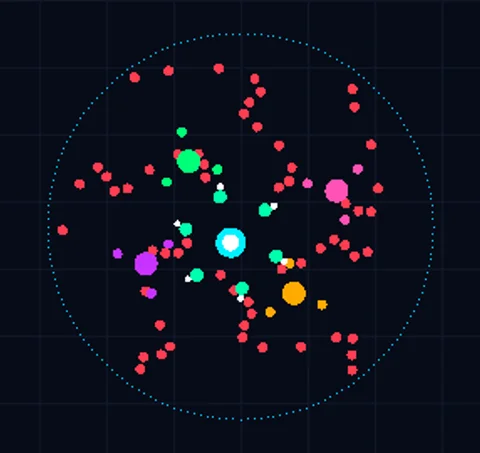
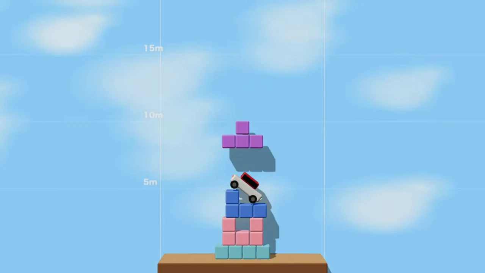
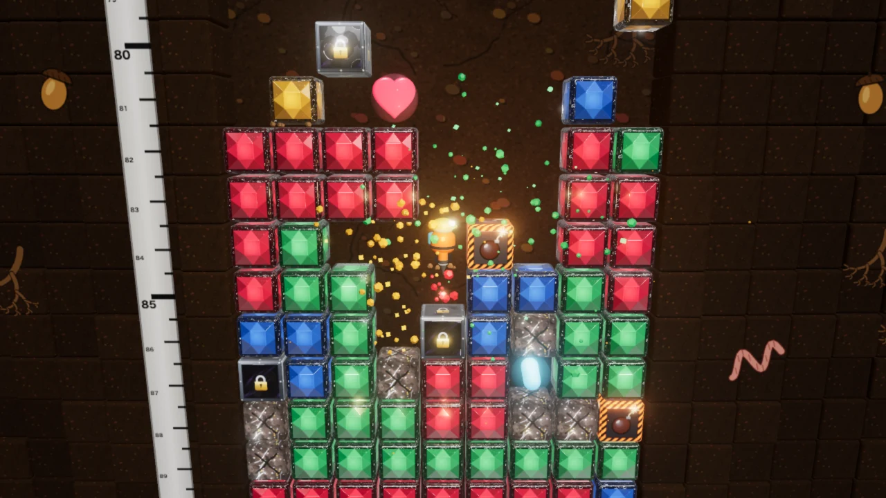

# gamecenter｜ひとりでも、みんなでも。はじめてでも、やり込みたい人でも。

ブラウザで遊べる、自作ミニゲーム10本のゲームセンターです。

- **すぐ遊びたい人に:** 単位増殖ラン、極限ギリギリ選手権
- **みんなで遊びたい人に:** ミッドナイト・スカイウェイ、剛体大相撲、グラグラタワー
- **競いたい人に:** えんにち射的、サバイバー・スコアバトル
- **腕に自信のある人に:** テンパレラン、ストリートビーボーイ、無限降下ドリル

## ゲーム

<table>
  <tr>
    <td width="50%" valign="top">
      
      <p><b>ミッドナイト・スカイウェイ</b><br>夜の峠道を走るタイムアタックレース。</p>
    </td>
    <td width="50%" valign="top">
      
      <p><b>剛体大相撲</b><br>相手を土俵の外へ押し出す物理相撲ゲーム。</p>
    </td>
  </tr>
  <tr>
    <td width="50%" valign="top">
      
      <p><b>テンパレラン</b><br>先生から逃げて校舎を走るランゲーム。</p>
    </td>
    <td width="50%" valign="top">
      
      <p><b>ストリートビーボーイ</b><br>ブレイクダンスで街を駆け抜けるアクションゲーム。</p>
    </td>
  </tr>
  <tr>
    <td width="50%" valign="top">
      
      <p><b>単位増殖ラン</b><br>ゲートで単位を増やして卒業を目指すランゲーム。</p>
    </td>
    <td width="50%" valign="top">
      
      <p><b>えんにち射的</b><br>屋台の景品をコルク銃で撃ち落とす射的ゲーム。</p>
    </td>
  </tr>
  <tr>
    <td width="50%" valign="top">
      
      <p><b>極限ギリギリ選手権</b><br>あふれる寸前や割れる寸前を狙うタイミングゲーム。</p>
    </td>
    <td width="50%" valign="top">
      
      <p><b>サバイバー・スコアバトル</b><br>回るブレードで敵を倒してスコアを競うサバイバルゲーム。</p>
    </td>
  </tr>
  <tr>
    <td width="50%" valign="top">
      
      <p><b>グラグラタワー</b><br>ブロックを積み上げて高さを競う物理パズルゲーム。</p>
    </td>
    <td width="50%" valign="top">
      
      <p><b>無限降下ドリル</b><br>ブロックを掘り進めて地下500mを目指すアクションゲーム。</p>
    </td>
  </tr>
</table>

## 特徴

### 1. ブラウザだけで動く

TypeScript で作り、3Dのゲームには Three.js を使っています。フルHD・60fps で動くように、場面ごとのフレーム落ちを計測して調整しました。

### 2. アーケード筐体で遊べる

ホーム画面からゲームの開始・終了まで、レバーとボタンだけで操作できます。

### 3. どの画面の形にも対応

超横長から縦長まで、黒帯を出さずに画面いっぱいに描きます。

### 4. ランキングとオンライン対戦

Node.js のサーバーで、スコアの記録とリアルタイム対戦を扱います。

## 手元で動かす

Node.js 22 で確認しています。推奨環境は Windows または macOS の Google Chrome です。`npm run dev` ではオンライン対戦が最初から開いているので、複数のタブで試せます。

```bash
git clone https://github.com/xxxxholica/gamecenter.git
cd gamecenter
npm install
npm run dev      # http://localhost:5173/ で全ゲームを起動
npm run build    # dist/ に1つのサイトとして組み立てる
```

## リポジトリの構成

```text
packages/
  hub/       ゲームを選ぶホーム画面
  games/     各ゲーム(Vite + TypeScript)
  shared/    全ゲーム共通の部品
  server/    ランキング・オンライン対戦のサーバー
scripts/     開発サーバーとビルドの道具
```

## クレジットとライセンス

### ライセンス

個人の趣味や学習などの非商用利用に限り、利用、改変、再配布ができます。商用利用はできません。

| 対象 | ライセンス |
|---|---|
| コード | [PolyForm Noncommercial 1.0.0](LICENSE) |
| 作者が制作または生成AIで作成した素材 | [CC BY-NC 4.0](LICENSE-ASSETS)(権利が及ぶ範囲) |
| 第三者の素材・フォント・ライブラリ | [THIRD_PARTY_NOTICES.md](THIRD_PARTY_NOTICES.md) |

再配布や改変版の公開では、説明文やクレジット画面など利用者が確認できる場所に、次のように表記してください。改変版には「改変あり」と添えてください。第三者の素材の表記は削除しないでください。

```text
gamecenter by xxxxholica, thousandl000, KURENAI-beat
https://github.com/xxxxholica/gamecenter
```

商用利用の相談と不具合の報告は [Issues](https://github.com/xxxxholica/gamecenter/issues)へ。脆弱性は Issues に書かず、[SECURITY.md](SECURITY.md) の方法で報告してください。

### 作者

| 作者 | ゲーム |
|---|---|
| [xxxxholica](https://github.com/xxxxholica) | ミッドナイト・スカイウェイ、テンパレラン、ストリートビーボーイ、単位増殖ラン、えんにち射的、極限ギリギリ選手権 |
| [thousandl000](https://github.com/thousandl000) | 剛体大相撲、グラグラタワー、無限降下ドリル |
| [KURENAI-beat](https://github.com/KURENAI-beat) | サバイバー・スコアバトル |

### 生成AIの利用

次の素材は生成AIで作成しています。

| 素材 | ツール |
|---|---|
| ミッドナイト・スカイウェイの車の3Dモデル | Google Antigravity |
| ゲームのロゴ・アイコン | Nano Banana |
| ミッドナイト・スカイウェイの BGM | Google Flow Music |

### 音楽

ミッドナイト・スカイウェイの BGM は、xxxxholica が Google Flow Music で制作しました。全5曲はプレイリスト [Soundtrack for "Midnight Skyway"](https://www.flowmusic.app/playlist/af44b588-9954-4fb4-bce0-000653f75215) で聴けます。

| 項目 | 内容 |
|---|---|
| 使用先 | ミッドナイト・スカイウェイ |
| 制作 | Google Flow Music |
| 曲 | Apex Lead、Cosmic Drift、PAVEMENT BURN、Redline、Touge Ronin |

### フォント

ライセンスはすべて [SIL Open Font License 1.1](https://openfontlicense.org/) で、全文は各フォントと同じフォルダーにあります。

| フォント | 使用先 | 著作権表示 |
|---|---|---|
| Yusei Magic | ホーム画面 | Copyright 2020 The Yusei Magic Project Authors |
| Mochiy Pop One | ホーム画面 | Copyright 2020 The Mochiypop Project Authors |
| Dela Gothic One | ミッドナイト・スカイウェイ | Copyright 2020 The Dela Gothic Project Authors |
| Noto Serif JP | 剛体大相撲 | Copyright 2012 Google Inc. |

### ライブラリ

主なライブラリは [Three.js](https://threejs.org/)、[cannon-es](https://github.com/pmndrs/cannon-es)、[ws](https://github.com/websockets/ws)、[Vite](https://vite.dev/) で、いずれも MIT ライセンスです。依存関係の全体は `package-lock.json` にあります。
